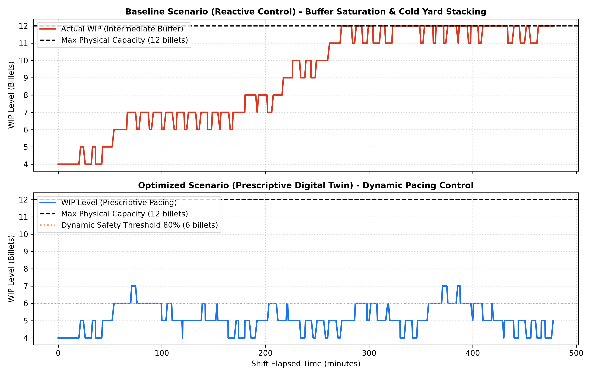

# Process Digital Twin: Continuous Casting & Rolling Mill Synchronization
### Operational Optimization at ArcelorMittal Gijón


---

## 1. Executive Summary & Problem Formulation

In integrated steel manufacturing facilities such as **ArcelorMittal Gijón (Veriña, Spain)**, a critical operational bottleneck occurs at the interface between the **Continuous Casting Machine (CCM)** and the **Hot Rolling Mill (RM)**.

* **Rigid Upstream Process:** Continuous casting solidifies molten steel into semi-finished billets at a continuous rate. Halting the caster abruptly leads to thermal shocks, severe refractory wear, and yield loss.
* **Stochastic Downstream Disruptions:** Hot rolling mills operate as discrete finishing systems subject to operational disruptions, such as mechanical micro-stoppages, cobbles, and guide adjustments.
* **The Thermal Penalty ($D_{cold}$):** Direct hot charging (introducing hot billets directly into the reheat furnace/rolling mill) minimizes natural gas consumption. However, when mill breakdowns occur and the intermediate holding buffer saturates ($B(t) \ge C_{max}$), billets must be diverted to an outdoor cold yard. Cold billets lose all thermal inertia, requiring extensive reheating, increasing specific fuel consumption (GJ/ton), and elevating Work-In-Process (WIP) holding costs.

This repository implements an operational **Process Digital Twin (DES)** using Python and **SimPy** to model shop-floor dynamics and evaluate a prescriptive pacing control policy.

---

## 2. Process Topology & Control Strategy

```text
+-----------------------+        +--------------------------+        +----------------------+
|  Continuous Casting   | -----> | Intermediate Hot Buffer  | -----> | Hot Rolling Mill     |
|  (Upstream Generator) |        | Capacity: C_max = 12     |        | (Single Server)      |
+-----------------------+        +--------------------------+        +----------------------+
                                               |
                                    If Buffer Level >= C_max
                                               v
                                 +--------------------------+
                                 | Cold Stacking Yard       |
                                 | (Thermal Loss Penalty)   |
                                 +--------------------------+

```
## 3. Evaluated Operating Policies

To quantify the operational and thermal benefits of digital twin intervention, two contrasting operational policies are implemented and benchmarked:

1. **Baseline Scenario (Reactive Control):**
   * **Control Logic:** The Continuous Casting Machine (CCM) operates at a constant nominal cadence ($T_{cast} = 11.5\text{ min}$) irrespective of downstream inventory levels.
   * **Failure Dynamics:** When the Hot Rolling Mill experiences stochastic breakdowns (cobbles, mechanical adjustments, or roll wear), processing ceases while casting continues.
   * **Consequence:** The compact buffer rapidly saturates to its physical upper bound ($B(t) \ge C_{max} = 12\text{ billets}$). Any subsequently cast billets cannot enter the buffer and are immediately diverted to an outdoor cold yard ($D_{cold}$).
   * **Operational Penalty:** Complete loss of latent thermal energy (cooling from ~900°C to ambient ~25°C), high specific fuel consumption upon eventual reheating, and elevated crane handling congestion.

2. **Prescriptive Scenario (Digital Twin Assisted):**
   * **Control Logic:** The Process Digital Twin continuously samples buffer occupancy $B(t)$ in real time.
   * **Dynamic Trigger:** Upon detecting that intermediate inventory reaches the proactive safety threshold ($B(t) \ge 6\text{ billets}$, representing 50% buffer capacity), the digital twin automatically prescribes a dynamic pacing command to the caster.
   * **Mitigation Action:** The casting cycle time is temporarily expanded by +50% ($\mu_{pacing} = 17.25\text{ min}$), throttling billet generation upstream until downstream roll clearances restore normal flow.
   * **Operational Benefit:** Prevents intermediate buffer overflow entirely, stabilizing Work-In-Process (WIP) and achieving zero cold yard diversions ($D_{cold} = 0$), preserving 100% hot-charging thermal integrity without abrupt plant shutdowns.

## 4. Key Performance Indicators (Shift 8h / 480 min)

Summary of experimental results obtained under fixed pseudo-random seed reproducibility (`seed = 42`):

| Operational Metric | Baseline Scenario (Reactive) | Prescriptive Digital Twin | Delta ($\Delta$) / Operational Impact |
| :--- | :---: | :---: | :--- |
| **Throughput (Billets finished)** | 29 | 35 | Line throughput stability |
| **Cold Diverted Billets ($D_{cold}$)** | 5 | 0 | **-100% Thermal energy loss penalty** |
| **Average Buffer WIP** | 9.07 | 5.14 | Buffer stabilization below upper limit |
| **Max WIP Level (Peak)** | 12 (Saturated) | 7 | Buffer overflow completely eliminated |
| **Buffer Saturation Index (%)** | 32.48 | 0.0% | Zero crane congestion and yard blockage |

## 5. Visual Output

The figure below illustrates the real-time dynamic behavior of the intermediate Work-In-Process ($WIP$) across an 8-hour production shift under both operating policies:

<p align="center">
  
</p>

* **Upper Panel (Baseline Scenario - Reactive Policy):** Unplanned mill stoppages cause intermediate buffer inventory to climb rapidly toward the physical boundary ($C_{max} = 12\text{ billets}$). When the holding yard saturates, excess semi-finished billets are forcibly diverted to the outdoor cold yard, incurring a critical thermal energy loss.
* **Lower Panel (Optimized Scenario - Prescriptive Digital Twin):** Continuous buffer monitoring triggers dynamic casting pacing once the inventory crosses the proactive safety threshold ($B(t) \ge 6\text{ billets}$). Caster output is throttled by +50%, stabilizing inventory within a controlled band and entirely eliminating cold yard overflows ($D_{cold} = 0$).

## 6. Repository Architecture

The project is structured following standard software engineering and computational modeling practices to decouple configuration data, simulation dynamics, reporting analytics, and visual output generation:

```text
arcelormittal-digital-twin-simpy/
├── config.py                 # System operational parameters & calibration
├── requirements.txt          # Python library dependencies
├── run_simulation.py         # Main execution script & comparative orchestration
├── src/
│   ├── __init__.py           # Package indicator
│   ├── plant.py              # SimPy environment, entities, and process generators
│   ├── analysis.py           # Operational KPIs calculation engine
│   └── visualizer.py         # Publication-grade chart generation (Matplotlib)
└── results/
    ├── figures/              # Exported high-resolution visual plots (PNG)
    └── logs/                 # Time-series simulation event data (CSV)
```

## 7. Getting Started & Execution Guide

Follow these steps to clone the repository, set up the computational environment, and run the simulation scenarios locally:

### 7.1 Prerequisites
* **Python 3.10+** installed on your system.
* **Git** installed and authenticated.

### 7.2 Installation Steps

1. **Clone the repository:**
   ```bash
   git clone [https://github.com/](https://github.com/)<your-username>/arcelormittal-digital-twin-simpy.git
   cd arcelormittal-digital-twin-simpy
   ```
## 8. Author & Academic Context

* **Author:** [Miguel Fernández Guerra]
* **Degree:** Industrial Management Engineering 
* **Host Institution:** University of Ruse (Erasmus+ Exchange)[cite: 1]
* **Home Institution:** University of Oviedo (Gijón Campus)[cite: 1]
* **Course:** Manufacturing Technologies[cite: 1]
* **Project Reference:** Process Digital Twin Prototype — Operational Synchronization at ArcelorMittal Gijón[cite: 1]
* **Academic Year:** 2026/2027

